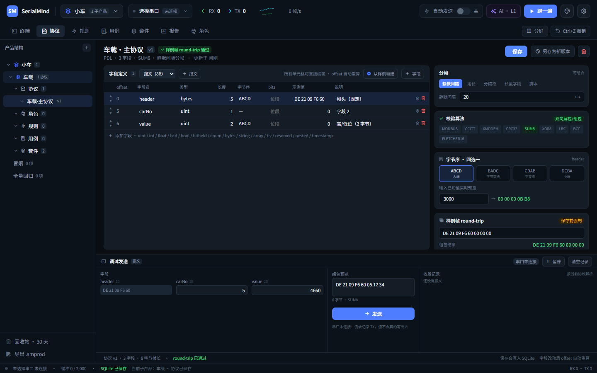
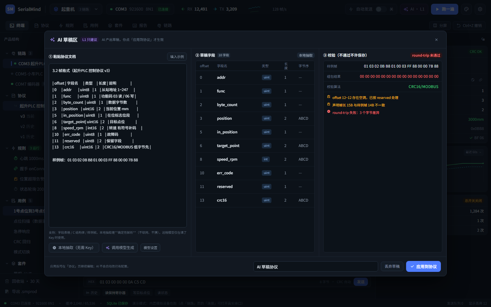
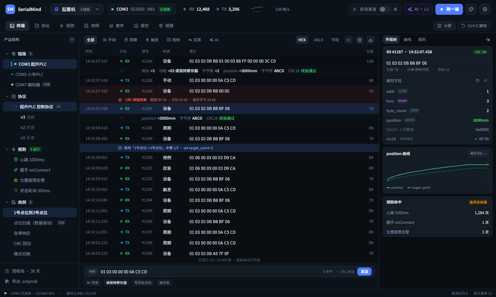
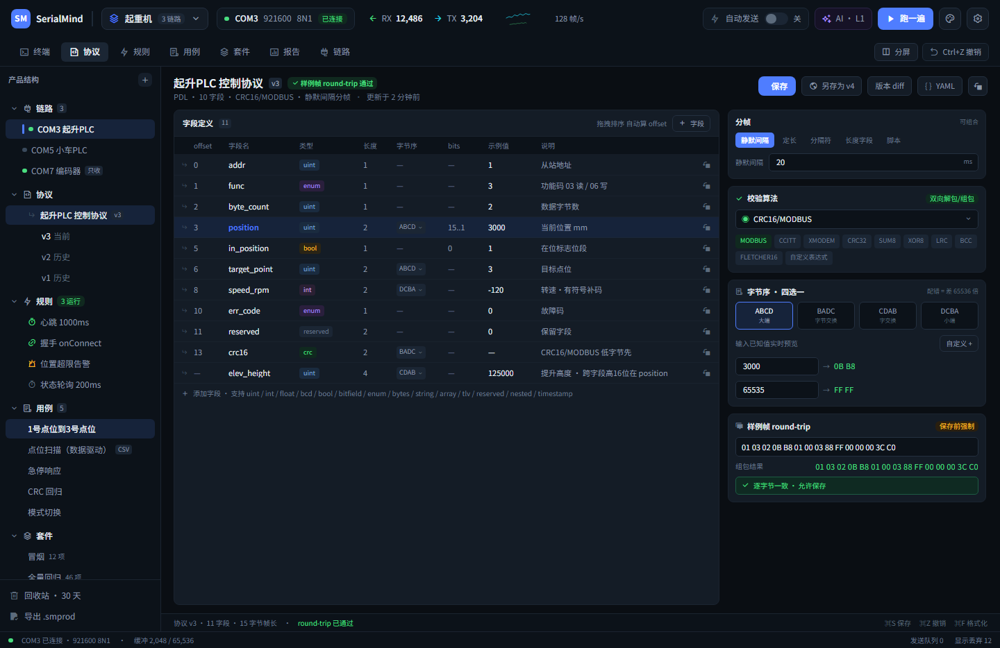

# SerialMind

> **一个能自己跑起来的 SScom。** 协议和用例配一次，之后每次改完固件点「跑一遍」，它告诉你哪条没过、字节差在哪。
>
> 跨平台 · 硬件无关 · 以自动化测试为唯一目标

**UI 按 Calicat 设计稿 1:1 还原** · 产品定义见 [docs/SerialMind-V1.0-定稿.md](./docs/SerialMind-V1.0-定稿.md)

> ⚠️ **本工程不含任何演示数据**。首次启动是空的：没有产品、没有链路、没有协议、没有用例、没有报文、没有报告。
> 所有数字（RX/TX、帧率、命中次数、通过率）都由真实操作产生。

---

## 三种跑法

```bash
npm install

npm run dev          # 浏览器：http://127.0.0.1:5273/
npm run desktop:dev  # 桌面端开发模式
scripts\build-desktop.cmd   # 打 exe + 安装包
```

页面直达：`#terminal` `#protocol` `#rule` `#case` `#suite` `#report` `#link`
round-trip 失败弹窗：`?modal=1#protocol` · AI 草稿区：`?ai=1`

> 浏览器用 **Chrome / Edge** 打开，Web Serial 可直接开真实串口。

---

## 自检与测试

```bash
npm test             # 引擎自检 14 项 + 执行引擎测试 26 项
npm run test:engine  # 只跑引擎自检（CRC 向量 / 字节序 / 组包解包 / 位段 / 帧识别）
npm run test:runner  # 只跑执行引擎测试（步骤 / 断言 / 超时 / 失败即停 / 套件）
npm run test:plc     # 非 Modbus 协议：帧头 / 长度字段 / 变长数据域 / 校验 / 分帧
npm run demo         # 端到端演示：Playwright 驱动真实浏览器走完整流程并截图
```

`npm run demo` 会真的操作 UI（用系统已装的 Edge，不下载浏览器）：

```
新建产品 → 新建链路 → AI 草稿抽取协议并应用 → 引擎自检 14 项
→ 新建用例并添加 3 个步骤 → 运行用例 → 报告页看真实结果 → 刷新验证 SQLite 恢复
```

截图输出到 `docs/demo/`。当前结果 **23/23 通过**。

应用内也有同一套自检：**顶栏 ⚙ 设置 → 引擎自检**，会真实执行 14 项断言并显示实际值。

当前结果：

```
引擎自检     14/14 通过
执行引擎测试  26/26 通过
```

执行引擎测试覆盖的行为（全部真实断言，非 mock）：

| 场景 | 断言 |
|---|---|
| set 步骤 | 真的组包并写了串口 |
| expect 步骤 | 真的等到回包，拿到实际字段值 |
| 断言不满足 | 必须失败，并记录期望 vs 实际 |
| 链路未连接 | expect 必须超时，原因写明「链路未连接」 |
| CRC 错帧 | assertNo 必须抓到 |
| 失败即停 | 后续步骤不再执行 |
| 套件执行 | 逐条产出结果，带套件名 |
| 空用例 | 必须失败，不能假通过 |

---

## 已完成的能力

### A. 桌面应用（Tauri 2）

| 产物 | 大小 |
|---|---|
| `src-tauri\target\release\serialmind.exe` | **5.8 MB** |
| `src-tauri\target\release\bundle\nsis\SerialMind_0.1.0_x64-setup.exe` | **3.93 MB** |

> 字体做过子集化：只用 2 个字重（400/600）× 中文/拉丁两个子集，共 5 个 woff2 文件 2.40 MB，
> 替代原来 785 个分片 / 21.25 MB。整个前端产物 3.49 MB。

Rust 侧真实串口：`list_ports` / `open_port` / `write_port` / `close_port`，数据经 `serial://data` 事件流回前端。
前端 `serial.ts` 双实现：桌面走 Tauri 命令，浏览器自动退回 Web Serial。

### B. SQLite 持久化（真 SQL）

- `sql.js`（WASM SQLite）建表 / 索引 / 事务 / 软删除，数据库字节流落 IndexedDB
- 表结构：`product / link / protocol / case_item / suite / rule`，均带 `tenant_id`、`rev`、`created_at / updated_at / deleted_at`
- 所有 SQL 集中在 `src/engine/repo.ts`（Repository 层）
- 状态栏实时显示 `SQLite 已保存 / 载入中 / 异常`

### C. CRUD（都可真正编辑并落库）

| 实体 | 能力 |
|---|---|
| 产品 | 新建 / 切换 / 重命名 / 删除（多产品数据分桶互不干扰） |
| 子产品 | 新建（**先选协议类型**：PLC 默认 / 通用二进制 / Modbus RTU / 空白）/ **拖拽排序** / **复制** / 重命名 / 删除 |
| 协议 | 一个子产品下**可建多个**（心跳 / 上线 / 查询…）；**拖拽排序** / **复制** / **一键发送**（树里点绿色箭头）；协议内可加多个**报文** |
| 角色 / 规则 / 用例 / 套件 | **拖拽排序** / **复制**（右键菜单） |
| 字段 | 增删 / 上下移动 / **复制**（⧉）/ 类型与算法设置 |
| 角色 | 新建（名称 + 站号 + 备注）/ 编辑 / 删除 |
| 串口 | 顶栏选择器：扫描端口 → 选 COM → 选波特率 → 连接/断开；**模拟设备（回环）** 可无硬件验证收发 |
| 协议 | **字段表只留 偏移 / 字段名 / 长度 / 值 / 说明**，值随便填：`5`（十进制）、`0x1F`（十六进制）、**`DE 21 09 F6 60`（字节串，长度自动跟着变）**；类型·字节序·位段·枚举·变长·固定值都在每行 ⚙ 里；增删字段、上下移动（offset 自动重算）、多报文、分帧与校验算法可改、**保存写入 SQLite**、round-trip 不一致时拦截并提供「强制保存」 |
| 用例 | 新建 / 复制 / 重命名 / 删除 / **步骤增删改** / 绑定链路下拉 |
| 规则 | 新建 / 开关 / 重命名 / 删除 |
| 套件 | 新建（按标签筛选用例）/ 运行 / 删除 |

### C0. 对象模型（v2）

```text
产品 Product（起重机）
└── 子产品 SubProduct（起升控制）      ← 建的时候选协议类型（PLC / Modbus / 空白）
    ├── 协议 Protocol ×N              ← 一个子产品可以有多个：心跳 / 车辆上线 / 状态查询…
    │                                 默认「PLC 模板」：header|len|len反码|cmd|data0|data1|sum
    │    └── 报文 Message ×N          ← 一个协议内可加多个报文（命令字不同）
    ├── 角色 Role（起升PLC 站1 / 上位机 站0 / 变频器 站2）  ← 总线上的身份，不持有串口
    ├── 规则 Rule
    └── 用例 Case（跑在某个角色上）
套件 Suite（产品级）
```

**串口不在结构里**：顶栏的串口选择器负责选 COM 口 + 波特率 + 连接/断开，属于运行时状态，不落库。

### C2. 产品树（左侧导航）

- 分组**可折叠/展开**（点分组行或 chevron）
- 每个分组 hover 出 **+**，直接新建该类型
- 每个节点 hover 出 **⋯**，或**右键**弹菜单：运行 / 重命名 / 复制 / 连接断开 / 删除
- 产品节点右键：重命名 / 删除产品
- 删除一律二次确认；改名/删除都写入 SQLite，刷新后仍在

> 早期版本的协议表是只读展示、保存不落库；已重写为真编辑器，并用端到端演示验证「改字段 → 保存 → 刷新仍在」。

### C3. 产品树交互

- **拖拽排序**：子产品 / 协议 / 角色 / 规则 / 用例 / 套件 同级之间拖动即换位置，顺序写入 `sort_order` 落库，刷新保持
  > 桌面端需 `tauri.conf.json` 里 `"dragDropEnabled": false`（否则 Tauri 会把拖拽当文件拖放拦截，HTML5 拖拽失效）
- **右键上移/下移**：所有树节点都有，不依赖拖拽（键盘/触控板更稳）
- **跨级拖拽**：协议/角色/规则/用例 可以拖到**另一个子产品**下（归属跟着改；用例跨子产品会解绑角色）
- **字段拖拽**：协议页字段行左侧 ⠿ 拖动即可调顺序，offset 自动重算（校验字段仍强制在帧尾）
- **复制**：右键 →「复制 xx」，生成「xx 副本」
- **协议一键发送**：协议行右侧绿色箭头 → 用字段默认值组包并发出（状态栏显示「已发送 xxx N 字节」）

### D0. 协议调试面板（协议页底部）



- **按协议字段自动生成表单**：数值输入、枚举下拉、bool 开关、**固定帧头可直接改**
- **每个字段都能切 HEX / 十进制**（包括自动计算字段和固定帧头）：
  - 普通字段：填 `530` 自动按大端写成 `02 12`，不用手算高低位
  - 自动字段（len / 反码 / sum）：切换后显示**实际值**，HEX `09` ↔ 十进制 `9`
  - 固定帧头：切换后显示十进制（`DE 21` = 56865），改十进制会自动转回 HEX 字节
  - 枚举字段：下拉项按所选进制显示
- **只有自动计算的字段只读**：校验和 / 整帧长度 / 反码等；其余全部可改（不落库，只影响本次发送）
- **实时组包预览**：改一个字段，下面 HEX 立刻变（含自动校验）
- **发送**：直接写串口（未连接也会记录 TX 便于验证组包）
- **收发记录**：按当前协议解析成 `header=… carNo=5 value=4660`，坏帧标红

### D. 自动化测试（已打通）

> **上手先看 [`docs/自动化配置指南.md`](./docs/自动化配置指南.md)** —— 照着点就行，5 步跑通。
> 用例页空状态里有「**一键生成示例用例**」：自动用当前协议建一个能跑的用例（发帧 + 断言），先跑通再改。


**用例步骤类型**

| 步骤 | 作用 | 写法示例 |
|---|---|---|
| `send` | 发原始字节（按开关自动补校验） | `DE 21 09 F6 60 01 00 00 5F` |
| `set` | 改字段 → 按协议组包发送 | 字段 `cmd`，值 `= 0x61` |
| `expect` | 等回包并断言字段 | 字段 `cmd`，断言 `equals 96` |
| `assertNo` | 时间窗内不该出现的异常 | `crc_error` |
| `delay` | 延时 | `500ms` |
| `loop` | 循环 | `3 次` |

**断言语法**：`equals 3000` / `range 1000..4000` / `in 1,3,5` / `> 100` / `< 50`
**超时**：`3s` / `500ms`；超时未满足即判失败

**数据驱动（CSV）**

用例「数据驱动」页直接贴 CSV：

```csv
want,note
96,第一行
96,第二行
```

步骤里用 `${want}` 引用列值，**一行跑一次，全部行通过才算通过**。

**执行与报告**
- 单条用例：用例页「运行用例」
- 批量：套件页「运行套件」/ 顶栏「跑一遍」（按标签筛选用例）
- 报告：通过/失败、耗时、每一步的期望/实际、失败原因
- **报告落库**（`run_result` 表），刷新、重启都不丢；可导出 HTML / JUnit XML
- 「复跑失败 N 项」只重跑上次失败的用例

### D. 测试执行引擎（真实运行）

- 步骤：`send` / `set` / `expect` / `assertNo` / `delay` / `loop` / `parallel`
- 断言基于**解包后的字段值**：`equals` / `range` / `in` / `>` / `<`，带超时
- `assertNo` 真实检查窗口内的 CRC 错帧、多余帧
- 失败即停；每步记录期望 / 实际 / 耗时 / 原始字节
- 结果写入 `runs`，报告页是**唯一消费方**；支持导出真实 HTML 与 JUnit XML
- 「复跑失败」只重跑上次失败的用例

### E. 自动发送规则（真实驱动）

- 引擎每 200ms 评估一次触发器；`每 1000ms` 这类周期规则在开启顶栏「自动发送」后真实发帧
- 命中次数、上次触发时间都是真实计数；`onConnect` 类规则在连接建立时触发一次
- 链路未连接时不写串口（不会假装发送成功）

### F. AI 草稿区（L1 只建议）

- **本地确定性抽取**（无需 Key、不联网）：C 结构体 / Markdown 表格 / 样例帧 → 字段表
- **远程模型**（OpenAI 兼容：DeepSeek / 通义 / Kimi / Ollama）：强制 JSON，未确定的校验算法必须返回 `null`
- 同一套校验器兜底：字段连续性 → 长度自洽 → 样例帧 round-trip → 校验算法穷举
- 草稿只进草稿区，点「应用到协议」才写库

### G. 协议引擎（不绑定 Modbus）

- **通用二进制模板**（新建协议默认）：`帧头 AA55 | len(1) | cmd(1) | data(len-5) | sum(1)`
- **帧头 / 帧尾**：`framing.prefix` / `suffix`，解码时校验对齐
- **变长数据域**：字段支持 `sizeExpr`（如 `len - 5`）与 `offsetExpr`（如 `len - 1`），带沙箱表达式求值器
- **固定字节帧头**：字段 `hex`（如 `DE 21 09 F6 60`），逐字节校验，不用把 5 字节头填成巨大十进制
- **从样例帧建协议**：粘贴一帧 + 切分 `5:header,1:carNo,2:value` → 自动生成字段；
  **切分留空 = 整帧一个字段**，直接当固定报文收发
- **字段枚举**：**按十六进制填** `60=启动, 61=停止`（要十进制写 `d96=启动`），解码显示「60 启动」
- **自动补校验和**：终端手动发送框、协议调试面板、用例 raw 发送步骤，都按当前协议算法（SUM8/XOR8/CRC16…）自动追加
### PLC 默认模板（新建子产品即得）

| 字段 | 类型 | 长度 | 值 |
|---|---|---|---|
| header | bytes | 2 | `DE 21`（固定帧头） |
| len | uint | 1 | **自动 = 整帧长度** |
| lenInv | uint | 1 | **自动 = 0xFF - len** |
| cmd | uint | 1 | `60` |
| data0 | uint | 1 | `01` |
| data1 | uint | 2 | `00 00` |
| sum | crc | 1 | **自动 = ADD8** |

组包结果：`DE 21 09 F6 60 01 00 00 5F`（9 字节）

**所有数值字段默认按十六进制显示和填写**：填 `60` 就是 `0x60`，不会变成 `3C` 或 `96`。

- **自动长度字段**：字段 ⚙ →「整帧长度（自动算）」→ 组包时自动写入真实帧长
- **计算字段**：字段 ⚙ →「长度反码 0xFF - len」/「长度补码 0x100 - len」/ 自定义表达式，值自动算并校验
- **值格式**：字段 ⚙ →「十六进制」→ `len` 显示成 `0A` 而不是 `10`
- **固定值校验**：字段 `expect`，帧头/命令字不匹配即报错
- **流式分帧器**：`帧头对齐 → 长度字段 → 定长 / 分隔符 / 静默间隔`，自动丢弃噪声、半帧等待、一包多帧
- **22 种校验算法**（全部按标准测试向量校验过）：
  - 累加/异或：`ADD8`（=SUM8，你说的 add8）、`ADD16`、`INV8`（0xFF-Σ）、`NEG8`（0x100-Σ）、`LRC`、`XOR8`、`BCC`、`NEGXOR8`
  - CRC8：`CRC8`、`CRC8/MAXIM`、`CRC8/SAE-J1850`、`CRC8/ROHC`
  - CRC16：`CRC16/MODBUS`、`CRC16/ARC`、`CRC16/CCITT`、`CRC16/XMODEM`、`CRC16/X25`、`CRC16/DNP`、`CRC16/USB`、`FLETCHER16`
  - CRC32：`CRC32`、`CRC32C`
  - 界面上每个算法都带中文名 + 计算公式 + 占用字节数
- 字节序 ABCD/BADC/CDAB/DCBA 双向换算、round-trip 逐字节比对与差异归因
- Modbus RTU 仍作为模板保留（`CRANE_PROTOCOL`），不强制使用

---

## 截图

| 空状态（首次启动） | AI 草稿区 |
|---|---|
|  |  |

| 主工作台（设计稿还原） | 协议编辑器 |
|---|---|
|  |  |

> 01~07 是按 Calicat 设计稿 1:1 还原的**版式**截图，当时用示例数据展示版式；当前程序默认无数据。

---

## 环境说明（本机踩过的坑）

这台机器的 **Windows SDK 只装了空目录**（`Include` / `Lib` / `bin` 都没有实际文件），导致 Rust MSVC 链接失败：

| 报错 | 处理 |
|---|---|
| `LNK1181: kernel32.lib` | 补 `Microsoft.Windows.SDK.CPP.x64` 的导入库 |
| 头文件缺失 | 补 `Microsoft.Windows.SDK.CPP` 的头文件 |
| `RC.EXE not found` | 补 SDK `bin\10.0.22621.0\x64`（rc.exe / mt.exe） |
| `vcvars64` 不设 `LIB` | `scripts\build-desktop.cmd` 显式设置 `LIB` / `INCLUDE` / `PATH` |

**不要直接 `npx tauri build`**，用 `scripts\build-desktop.cmd`。

网络受限环境：Rust 工具链走清华镜像；crates.io 走 rsproxy 稀疏索引（`~/.cargo/config.toml`）。

---

## 技术栈与目录

| 层 | 选型 |
|---|---|
| 桌面外壳 | Tauri 2 + Rust `serialport` |
| 前端 | React 19 + TypeScript + Vite 7 |
| 状态 | Zustand |
| 存储 | sql.js（WASM SQLite）+ IndexedDB |
| 样式 | 原生 CSS + 设计 token（取自设计稿实测值） |
| 字体 | Noto Sans SC + Remixicon（设计稿同一批码点） |
| 测试 | tsx 脚本（引擎自检 + 执行引擎测试） |

```text
src/engine/
├── bytes.ts     # 十六进制 / 字节序换算
├── crc.ts       # 9 种校验算法
├── pdl.ts       # PDL 类型
├── codec.ts     # 组包 / 解包 / round-trip / 校验算法判定
├── runner.ts    # 测试执行引擎（真跑）
├── selftest.ts  # 引擎自检 14 项
├── serial.ts    # Tauri ↔ Web Serial
├── db.ts        # sql.js + IndexedDB
├── repo.ts      # Repository 层
├── ai.ts        # 本地抽取 / 远程模型 / 校验器
├── types.ts     # 领域类型
└── store.ts     # 状态 + CRUD + 规则引擎 + 持久化
scripts/
├── build-desktop.cmd   # 桌面构建（含 MSVC 环境）
├── test-engine.ts      # 引擎自检
├── test-runner.ts      # 执行引擎测试
└── sync-calicat-docs.ps1
```

---

## 下一步

1. **字体子集化**：exe 25 MB 主要是中文字体，只保留用到的字形可压到 ~10 MB
2. **原生 SQLite**：`repo.ts` 换 rusqlite（桌面端），浏览器端保留 sql.js
3. **数据驱动用例**：CSV 参数化已留字段，尚未接执行
4. **原生 SQLite**：桌面端接 rusqlite（现在两端都用 WASM SQLite）
