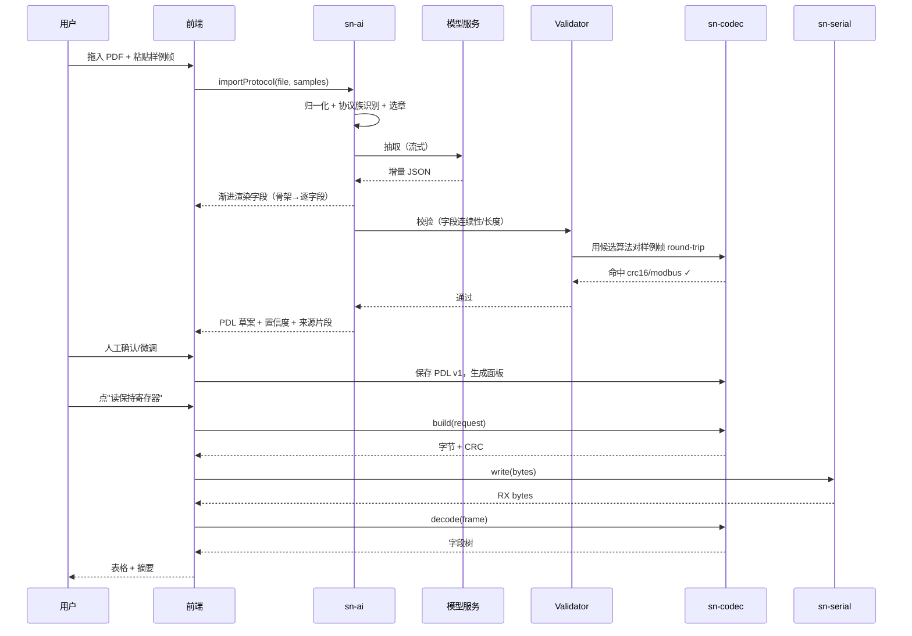

# SerialMind —— 跨平台智能串口调试工作台

> **产品与技术方案（V0.1 草案）**
> 代号：**SerialMind**（备选名：PortSmith / FrameLens）
> 对标：SScom 5.x、XCOM、SecureCRT、Serial Studio
> 定位一句话：**一个长得像 2025 年的 SScom —— 跨平台、协议可编程、把"协议文档"一键变成"能点的调试面板"。**

---

## 0. 文档信息

| 项 | 内容 |
|---|---|
| 文档版本 | V0.1（草案，待评审） |
| 日期 | 2026-02（初稿） |
| 作者 | 产品 + 架构 |
| 阅读对象 | 你（产品决策者）、前端、Rust 后端、测试 |
| 文档性质 | **方案文档，不含实现代码**。文中的 JSON / DSL 片段是"规范草案"，不是源码 |
| 后续动作 | 评审 → 确认第 19 章开放问题 → 再进入脚手架搭建 |

### 阅读路线建议

- 只想看"这东西做成什么样"：读 **第 1、3、7、13 章**
- 关心 AI 到底怎么落地、会不会瞎编：读 **第 8 章**（全文最重要）
- 关心能不能扛住高速串口、跨平台坑在哪：读 **第 10、11、16 章**
- 关心多久能做完：读 **第 6、17 章**

---

## 1. 摘要：一页看懂

### 1.1 我们要做什么

做一个**跨平台（Windows / macOS / Linux）的串口调试工具**，能力上覆盖 SScom 的全部日常功能（收发、HEX/ASCII、定时发送、日志），但在三件事上形成代差：

| 支柱 | 具体含义 | 为什么难被抄 |
|---|---|---|
| **好看** | 现代设计语言：暗色优先、字段级着色、虚拟滚动、克制动效、6 套可导入主题 | 需要完整设计系统，不是换个皮肤 |
| **跨平台** | 三平台体验一致，包体 < 25 MB，冷启动 < 1.5 s | Tauri + Rust，不是 Electron 套壳 |
| **智能** | 把上/下位机协议文档（PDF/Word/文本/C 头文件/样例报文）**自动转成结构化协议定义**，并自动生成可点击的调试面板 | 需要"LLM + 确定性校验器 + 样例帧自测"的闭环，纯 Prompt 做不到 |

### 1.2 一句话用户价值

> 以前：拿到一份 30 页的协议文档 → 手算 CRC、手敲 16 进制、对着字节数偏移 → 半天才发出第一帧。
> 现在：把文档拖进来 → 30 秒后得到一张带字段名、枚举下拉、CRC 自动算的调试表单 → 点"发送"。

### 1.3 三条产品红线（防止做成四不像）

1. **不做 IDE**。它是调试工具，不是通用编程环境。脚本能力只服务于"造帧 / 判包 / 批测"。
2. **AI 不许静默猜**。任何无法从文档确定的字段（尤其校验算法），必须显式标记"待确认"并给出候选，绝不悄悄编一个。
3. **离线可用是底线**。不配 AI Key 时，它必须是一个**完整好用**的传统串口工具；AI 是增强，不是前提。

---

## 2. 背景：SScom 到底哪里不够用

SScom（丁丁串口调试助手）是国内嵌入式圈事实标准之一，优点是**极轻、极快、极稳定、零学习成本**。但它的能力模型停留在 2008 年：

| 维度 | SScom 现状 | 实际痛点 |
|---|---|---|
| 平台 | 仅 Windows（Win32 原生） | macOS / Linux 开发者无法使用；M 芯片/ARM Linux 完全不支持 |
| 界面 | 固定字号、固定配色、无 DPI 友好缩放 | 4K 屏字小如蚁；长时间盯屏眼疲劳；截图进周报很难看 |
| 协议层 | 只有 HEX / ASCII 两种视图 | **不理解帧结构**：看到的是一坨字节，字段含义靠脑子记 |
| 造帧 | 手敲十六进制，CRC 要外部工具算 | 一个 20 字节的帧，改一个字段要重算 CRC；易错 |
| 快捷发送 | 有限条静态列表 | 无法参数化、无法分组、无法从协议自动生成 |
| 多端口 | 弱 | 无法同时开 3 个口做上下位机对拖、无法并排对比 |
| 高吞吐 | 高波特率 + 大量输出时 UI 卡顿、丢显示 | 921600 持续刷屏会假死 |
| 数据 | 纯文本日志 | 无结构化存储、无回放、无统计、无图表 |
| 自动化 | 无 | 产线批测、回归测试只能人肉点 |

> **结论**：SScom 的"轻"值得继承，"不懂协议"必须解决。竞品里 Serial Studio 解决了可视化，YAT/Termite 解决了跨平台，**但没有一个解决"协议文档 → 可执行调试界面"的转化**。这就是我们的切口。

---

## 3. 竞品与差异化定位

### 3.1 竞品矩阵

| 工具 | 平台 | UI 现代度 | 协议解析 | 可视化 | AI | 自动化 | 价格 |
|---|---|---|---|---|---|---|---|
| **SScom** | Win | ★☆☆☆☆ | 无 | 无 | 无 | 无 | 免费 |
| **XCOM**（正点原子） | Win | ★★☆☆☆ | 有限（固定模板） | 无 | 无 | 无 | 免费 |
| **YAT / Termite** | Win | ★★☆☆☆ | 无 | 无 | 无 | 无 | 免费 |
| **SecureCRT** | 三平台 | ★★☆☆☆ | 无 | 无 | 无 | 有脚本 | 付费（贵） |
| **Serial Studio** | 三平台 | ★★★★☆ | 中（需自己写 JSON） | ★★★★★ | 无 | 弱 | 开源免费 |
| **Tabby** | 三平台 | ★★★★★ | 无（偏 SSH 终端） | 无 | 有（终端侧） | 有 | 开源 |
| **SerialMind（本方案）** | 三平台 | ★★★★★ | **强（AI 生成 + 手写 DSL）** | ★★★★☆ | **核心能力** | 有 | 待定 |

### 3.2 差异化定位图

```text
                    协议理解能力 →
        弱 ──────────────────────────────────────── 强
      ┌──────────────────────────────────────────────┐
  高  │  Tabby                        ★ SerialMind   │
     │  Serial Studio(可视化强)                      │
  U  ├──────────────────────────────────────────────┤
  I  │  XCOM                                        │
  现  │  YAT / Termite                               │
  代  ├──────────────────────────────────────────────┤
  度  │  SScom / SecureCRT                           │
  低  │                                              │
      └──────────────────────────────────────────────┘
```

**我们的护城河只有一条：协议理解。** UI 好看会被抄，跨平台会被抄，"给一份协议文档就能自动生成调试界面 + 自动判包 + 自然语言下指令"这件事，抄起来需要完整的工程闭环。

### 3.3 目标用户（按优先级）

| 优先级 | 人群 | 核心任务 | 付费意愿 |
|---|---|---|---|
| P0 | 嵌入式/单片机工程师 | 调试 UART 协议、抓异常帧 | 中（个人可付，公司更可付） |
| P0 | 上位机/驱动开发者 | 验证下位机回包、批量回归 | 高 |
| P1 | 产线测试/售后工程师 | 一键跑测试用例、出报告 | 高（企业授权） |
| P1 | 高校/培训 | 教学演示、协议原理可视化 | 低 |
| P2 | IoT 模组厂 FAE | 给客户演示、快速定位 | 中 |

### 3.4 关键使用场景（Scenario）

**S1｜首次接一个新协议（核心场景）**
拿到传感器手册（PDF，含寄存器表 + 帧格式图）→ 拖进 SerialMind → AI 生成协议定义 + 字段表单 → 点"读版本号" → 回包自动解析成 `温度=25.3℃, 湿度=61%` → 保存为协议模板分享给同事。

**S2｜现场排障**
客户反馈"偶发丢包"→ 开录制 → 跑 2 小时 → 帧列表里 CRC 错误帧标红、超时帧标黄 → 点"AI 分析"→ 输出："从 14:32 起出现 3.5ms 静默间隔，符合 Modbus RTU 分帧规则，但第 8 帧长度字段与实际不符，疑似下位机缓冲区溢出"。

**S3｜自然语言调试**
输入："读从站 1 的保持寄存器 0x0000 起 10 个" → 自动组包 `01 03 00 00 00 0A C5 CD` → 发送 → 回包解析为 10 个寄存器的表格 + 一句话摘要。

**S4｜多口对拖**
同时开 COM3（上位机模拟）和 COM5（被测设备），中间做转发/对比，观察双方交互时序。

**S5｜产线批测**
导入测试用例（发 A 期望 B、超时 500ms、重试 2 次）→ 一键跑 100 轮 → 出 HTML/CSV 报告。

---

## 4. 产品目标与成功指标

### 4.1 目标（V1.0 发布时）

| 类型 | 指标 | 目标值 |
|---|---|---|
| 体验 | 冷启动到可操作 | < 1.5 s（Win/macOS 主流机） |
| 体验 | 安装包体积 | < 25 MB（不含 AI 模型） |
| 体验 | 空闲内存 | < 150 MB |
| 性能 | 持续接收 2 MB/s 不丢帧、UI 不卡（60 fps） | 达标 |
| 性能 | 100 万行日志滚动流畅 | 达标（虚拟滚动） |
| 智能 | 协议文档 → 定义，字段抽取准确率（自建 20 份评测集） | F1 ≥ 0.90 |
| 智能 | 有样例帧时校验算法识别率 | ≥ 0.95 |
| 智能 | 从"拖入文档"到"发出第一帧"耗时 | < 3 分钟（含人工确认） |
| 稳定 | 8 小时连续收发无崩溃、内存增长 < 5% | 达标 |
| 口碑 | 三平台 UI 一致性（截图对比） | 无肉眼可见差异 |

### 4.2 北极星指标

**周活跃"成功发出第一帧"的新协议数量** —— 直接衡量"协议理解"这个护城河是否真的成立。

---

## 5. 功能全景（功能地图）

```text
SerialMind
├── 连接层
│   ├── 端口枚举 / 热插拔监听 / 端口占用检测
│   ├── 参数配置（波特率/数据位/停止位/校验/流控/DTR/RTS）
│   ├── 非标准波特率（自定义数值）
│   ├── 多会话并行（多端口、多标签、可拆分视图）
│   ├── 自动重连 / 断线原因提示
│   └── 虚拟串口对（内置 socat 式 pair，用于自测与演示）★
├── 终端层
│   ├── ASCII / HEX / 混合（ASCII 可读部分按字符、不可读按 HEX）
│   ├── 时间戳（绝对/相对/开机毫秒）、方向标识、帧序号
│   ├── 帧着色（按协议字段语义）
│   ├── 搜索/过滤/高亮（正则、按字段、按方向）
│   ├── 折叠重复帧（N 次相同帧合并）
│   ├── 自动滚动/暂停/清屏/另存
│   └── 环形缓冲 + 磁盘落盘（超长日志不 OOM）
├── 发送层
│   ├── 单行/多行编辑、HEX/ASCII 输入、转义符
│   ├── 快捷发送列表（分组、拖拽排序、参数化模板）
│   ├── 定时/循环发送（间隔、次数、随机抖动）
│   ├── 文件发送（分块 + 延时）
│   ├── 帧尾自动追加（\r\n、CRC）
│   └── 变量与宏（时间、序号、随机、表达式）★
├── 协议层 ★核心
│   ├── 协议定义（PDL，见第 9 章）：字段、枚举、位域、变长、TLV、嵌套
│   ├── 校验算法库（CRC8/16/32、SUM、XOR、LRC、BCC、Fletcher）+ 自定义表达式
│   ├── 分帧策略（静默间隔/定长/分隔符/长度字段/脚本）
│   ├── 双向：解包（字节→字段）+ 组包（字段→字节）
│   ├── 请求/响应配对（事务追踪、超时、重试）
│   └── 协议模板库（Modbus RTU/ASCII、DL/T 645、NMEA 0183、AT、SCPI、自定义）
├── AI 层 ★核心
│   ├── 协议文档 → 结构化定义（多模态输入）
│   ├── 样例帧自测 + 校验算法自动判定
│   ├── 自然语言 → 组包 / 解析 / 脚本
│   ├── 实时流分析（异常检测、时序、根因提示）
│   └── 协议问答（"这个字段为什么是 0x0F？"）
├── 可视化层
│   ├── 实时曲线（字段值随时间）
│   ├── 帧统计（频率、长度分布、错误率）
│   ├── 位图/波形视图（ADC 数据、逻辑电平）
│   └── 仪表盘（可拖拽布局）
├── 数据层
│   ├── 录制（原始字节流 + 元数据，可回放）
│   ├── 回放（按时间轴/按帧步进）
│   ├── 导出（TXT / CSV / JSON / 结构化报告）
│   └── 工作区（连接配置 + 协议 + 布局，一键恢复）
└── 自动化层
    ├── 脚本（JS，可访问收发 API）
    ├── 测试用例（发/等/断言/超时/重试）
    ├── 批量执行 + 报告
    └── CLI 模式（CI 里跑，headless）★
```

★ = 差异化功能，非 SScom 能力。

---

## 6. 版本规划与范围控制

### 6.1 分期（MoSCoW）

| 版本 | 主题 | 必做（Must） | 暂不做（Won't） |
|---|---|---|---|
| **M0 骨架**（2 周） | 能连上、能收发 | Tauri 工程、端口枚举、连接、收发、HEX/ASCII、清屏 | 协议、AI、主题 |
| **M1 可用终端**（4 周） | 替代 SScom 日常 | 多会话、快捷发送、定时发送、日志落盘、搜索、暗色主题、快捷键 | 协议、AI |
| **M2 协议引擎**（4 周） | 懂协议 | PDL 定义 + 编辑器、CRC 库、分帧、解包/组包、字段树、请求响应配对、Modbus 模板 | AI、可视化 |
| **M3 AI 生成**（4 周） | 核心差异化 | 文档导入、LLM 抽取、校验闭环、样例帧自测、确认 UI、调试面板自动生成 | 实时分析 |
| **M4 智能 + 可视化**（3 周） | 体验拉满 | 自然语言组包、实时异常检测、曲线图、录制回放 | 脚本 |
| **M5 工程化 + 发布**（3 周） | 能交付 | 脚本、测试用例、CLI、三平台打包签名、自动更新、i18n、文档站 | 云端协作 |

**单人全职 + AI 辅助 ≈ 20 周；两人并行（前端 / Rust）≈ 12 周。**

### 6.2 明确不做（V1 不做，写进文档防止范围膨胀）

- ❌ 云端账号体系 / 团队协作（V2 再议）
- ❌ 逻辑分析仪、示波器硬件
- ❌ CAN / I2C / SPI 物理层（V2 可通过"协议插件"扩展，V1 不做）
- ❌ 通用 IDE（不做代码补全、不做调试器）
- ❌ 移动端
- ❌ 自己训练模型（只做推理侧集成）

---

## 7. 功能规格详述

### F1 连接管理

| 项 | 规格 |
|---|---|
| 端口枚举 | 显示 `COM3 — USB-SERIAL CH340 (COM3)`，含厂商/VID/PID/序列号 |
| 热插拔 | 插入/拔出实时更新，拔出时保留会话与历史，提示"设备已断开，等待重连" |
| 参数 | 波特率（标准下拉 + 自定义输入 1~20,000,000）、数据位 5/6/7/8、停止位 1/1.5/2、校验 None/Odd/Even/Mark/Space、流控 None/RTS-CTR/XON-XOFF |
| 控制线 | DTR/RTS 手动切换（很多开发板靠 DTR 复位，**必须有**） |
| 端口占用 | 打开失败时区分错误：`PermissionDenied`（Linux 需 dialout 组）/ `Busy`（被其他程序占用，提示占用进程名——Win 用 Restart Manager，mac 用 lsof，Linux 用 /proc）/ `NotFound` |
| 自动重连 | 可选：断线后按退避策略（200ms→2s）重连，重连后可选自动重发上一条 |
| 多会话 | 标签页 + 左右分屏（最多 4 格），每格独立会话；支持"复制会话配置" |
| 虚拟串口对 | 内置创建一对互连的虚拟串口（Win: com0com 检测/引导安装；mac/Linux: 内置 PTY 对），用于**无硬件自测与演示** |
| 统计 | 实时显示 RX/TX 字节数与速率（B/s、帧/s）、错误计数（校验错/溢出/帧错） |

**验收**：在 Win10/Win11、macOS 14（Intel+ARM）、Ubuntu 22.04 上均能枚举并打开 CH340、CP2102、FT232、原生 CDC 设备。

### F2 接收终端

**显示模式三选一**：ASCII、HEX、**混合**（默认：可打印字符直接显示，不可打印显示 `·` 并在悬停时给出 HEX）。

**行结构**（每行一个"帧"，未识别协议时按分帧策略或按接收块）：

```text
14:32:07.412  ← RX  #1284  01 03 14 00 FA 00 FB 00 F1 ...   [温度=25.0 湿度=25.1 ...]
└─时间戳      └方向 └序号  └原始字节（可折叠）                └解析摘要（协议启用时）
```

- 时间戳格式可配：绝对时间 / 相对首帧 / 相对上一帧 / 单调毫秒。
- **字段级着色**：同一帧内不同字段用不同语义色（地址=紫、功能码=蓝、数据=默认、CRC=灰、错误=红）。
- **折叠重复**：连续 N 次相同帧折叠为 `×12`，点击展开。
- **搜索**：支持文本、正则、HEX 模式；命中高亮并显示"第 3/47 个"，可跳转。
- **过滤**：按方向、按功能码、按字段值范围（如"只看温度 > 80 的帧"）。
- **性能**：环形缓冲默认 50 MB（可配 8~512 MB）；超出后最旧数据转存磁盘并释放内存；UI 采用虚拟滚动，只渲染可视区。
- **落盘**：可选择"实时写文件"（追加写 + 按大小/时间滚动，默认 64 MB/文件）。
- **导出**：TXT（原样）/ CSV（结构化字段）/ JSON（含字段树）/ HTML 报告。

### F3 发送

- 输入框支持多行；HEX 模式自动忽略空格与 `0x` 前缀；ASCII 模式支持 `\r \n \t \xNN \\` 转义。
- **快捷发送列表**：树形分组，拖拽排序，每项可命名、可绑定协议报文、可带参数（发送时弹小表单填值）。
- **定时发送**：间隔（可随机抖动 ±X ms）、次数（N 次 / 无限）、首次延迟。
- **文件发送**：分块大小 + 块间延时 + 可选 XMODEM/YMODEM（V2）。
- **变量**：`${time} ${seq} ${random:0-255} ${expr:...}` 在发送时展开。
- **历史**：上/下方向键调历史（像终端）。
- **危险操作保护**（配合 AI 场景）：命中"写/擦除/复位/升级"类命令时二次确认，可配置白名单跳过。

### F4 协议引擎（详见第 9 章 PDL）

能力要点：

1. **双向对称**：同一份定义既能解包（RX）也能组包（TX），不存在"解析器"和"生成器"两套配置。
2. **分帧策略**可插拔：静默间隔（Modbus RTU 3.5 字符时间）、定长、分隔符（`\r\n`）、长度字段（偏移+宽度+是否含头/含校验）、脚本（复杂变长）。
3. **校验**：内置算法库 + 自定义表达式；解包时校验失败标记为错误帧但**仍尽力解析**（便于排障）。
4. **事务追踪**：请求/响应按"地址+功能码+序号"配对，计算 RTT，超时标记；不匹配的响应标为"孤儿帧"。
5. **协议编辑器**：可视化字段表 + 右侧实时预览（用样例帧即时验证），支持 YAML/JSON 源码视图双向同步。
6. **模板库**：内置 Modbus RTU/ASCII、DL/T 645-2007、NMEA 0183、AT 指令、SCPI 常用集，用户可 Fork 修改。

### F5 协议文档 → 调试面板（AI 核心，详见第 8 章）

用户流程（**5 步，全部可回退**）：

```text
① 导入          ② 抽取            ③ 校验            ④ 确认              ⑤ 生成
拖入 PDF/Word/   识别协议族 →      样例帧 round-trip  并排对照原文档，     自动生成：
文本/C 头/图片   生成 PDL 骨架      CRC 自动判定      低置信度高亮         字段表单 + 命令集
/样例报文        → 逐字段填充      字段连续性检查    → 可改可删可补        + 快捷发送列表
```

### F6 自然语言指令（AI）

- 输入框前置 `/` 唤起 AI 指令（避免与普通文本发送混淆）。
- 示例：
  - `/读从站1保持寄存器 0x0000 起 10 个`
  - `/把温度阈值设成 30 度，然后连续读 20 次，间隔 200ms`
  - `/解析刚才那帧`
  - `/为什么 CRC 不对`
- 输出：**结构化动作**（发送哪一帧、做什么解析）+ 自然语言解释，先预览再执行（可关）。

### F7 实时分析（AI）

- **两级触发**（控成本的关键）：
  1. **本地规则引擎**（零成本，永远开）：CRC 错、超时、长度异常、字段越界、重复帧、频率突变、状态机非法跳转。
  2. **LLM 分析**（按需）：仅在①用户手动点"分析"、②规则引擎报警且用户开启"自动诊断"、③用户提问时调用。
- 输入给模型的是**压缩摘要**（最近 N 帧的统计特征 + 异常样本 + 协议定义），不是原始全量字节。
- 输出格式固定：`现象 / 可能原因（按概率排序）/ 建议动作（可点击执行）`。

### F8 可视化

- 字段曲线：选中任意数值字段 → 实时折线图（uPlot，10 万点无压力），支持多字段叠加、双 Y 轴、缩放。
- 帧统计面板：帧率直方图、长度分布、错误率时间线、功能码占比饼图。
- 位图/波形：把 bytes 字段按位展开成逻辑电平图（调试传感器原始 ADC 很有用）。
- 仪表盘：可拖拽卡片布局，随工作区保存。

### F9 录制 / 回放 / 导出

- 录制文件格式：`*.srec`（自有格式）= 头部元数据（JSON）+ 原始字节流 + 时间戳数组（变长编码），压缩可选 zstd。
- 回放：按真实时间轴、按倍速、按帧步进；回放时**协议解析器照常工作**，这是排障利器。
- 导出报告：HTML（自带样式，可截图进周报）/ CSV / JSON。

### F10 脚本与自动化

- 脚本语言：**JavaScript（QuickJS 沙箱）**，无需 Node 环境，API 极简：

  ```js
  // 概念示意
  port.write(frame.build({ addr: 1, func: 3, reg: 0x10, len: 4 }))
  const resp = await port.waitFor(f => f.fields.func === 3, { timeout: 500 })
  assert(resp.fields.values[0] === 0x1234, '寄存器值不符')
  ```

- 测试用例：YAML 声明式（发什么、等什么、断言什么、超时/重试/重试间隔），比脚本更低门槛。
- **CLI 模式**：`serialmind run cases/ --port COM3 --report out.html --headless`，可直接进 CI 或产线工装。

### F11 工作区与主题

- 工作区 = 连接配置 + 协议 + 快捷发送 + 布局 + 图表 + 脚本，存为 `.smproj`（JSON），可 Git 管理、可团队共享。
- 主题：内置 6 套（见 13.4），支持导入/导出 JSON 主题；跟随系统明暗。

---

## 8. AI 能力规格（全文最重要的一章）

> 这一章回答三个问题：**怎么让 LLM 输出可靠的结构化协议？怎么证明它没瞎编？怎么把成本压到能接受？**

### 8.1 总体原则

| 原则 | 落地手段 |
|---|---|
| **LLM 只做"理解与翻译"，不做"计算"** | CRC 算法、长度、偏移一律由**确定性代码**验证/计算，LLM 只提候选 |
| **结构强约束** | 强制 JSON Schema（function calling / structured output），拒绝自由文本 |
| **闭环自证** | 用用户提供的**样例报文**做 round-trip，不通过就不许"完成" |
| **可回溯** | 每个字段必须给出 `source_span`（原文出处片段）与 `confidence` |
| **可回退** | 生成物是"草案"，必须人工确认才落库；落库后带版本，可 diff/回滚 |
| **降级可用** | 无 Key / 断网 / 超额 → 手动 PDL 编辑与模板库照常可用 |

### 8.2 输入形态与预处理管线

```text
        ┌──────────── 输入 ────────────┐
        │ 文本粘贴  PDF  DOCX  MD  PNG  │
        │ C 头文件  抓包日志  样例报文  │
        └──────────────┬───────────────┘
                       ▼
   ┌─────────────────────────────────────────────┐
   │ 1. 归一化                                    │
   │    PDF → 文本 + 表格（pdfium/pdf-extract）    │
   │    DOCX → Markdown（保留表格）                │
   │    图片 → 多模态 OCR（帧格式图、寄存器表）     │
   │    C 头 → tree-sitter 解析 struct/enum/#define│
   │    抓包 → 字节序列 + 时间戳                    │
   ├─────────────────────────────────────────────┤
   │ 2. 结构化预处理（确定性，非 LLM）★            │
   │    表格 → 行列对齐（"偏移/名称/类型/说明"）    │
   │    struct → 字段名/类型/顺序（最可靠来源）     │
   │    样例帧 → 长度/字节分布/疑似校验位           │
   ├─────────────────────────────────────────────┤
   │ 3. 协议族识别（分类器 + 规则）                │
   │    Modbus RTU / ASCII / DL645 / NMEA / AT /  │
   │    SCPI / 自定义二进制 / TLV / 文本行协议      │
   │    命中已知族 → 直接套模板，LLM 只补差异       │
   ├─────────────────────────────────────────────┤
   │ 4. 分块抽取（两级 LLM 调用，避免长上下文遗忘） │
   │    Pass A：帧骨架（分帧方式/总长/字段分区）    │
   │    Pass B：逐字段细化（类型/枚举/位域/表达式）  │
   └─────────────────────────────────────────────┘
                       ▼
             PDL 草案（JSON）
                       ▼
   ┌─────────────────────────────────────────────┐
   │ 5. 确定性校验器（Validator）★ 见 8.4         │
   └─────────────────────────────────────────────┘
```

**关键洞察**：C 头文件、结构化表格这类"半结构化输入"比自由文本可靠一个数量级，应该**优先用确定性解析器**处理，LLM 只负责把"人话描述"补进去。这是准确率从 70% 提到 90% 的关键，也是很多 AI 产品没做对的地方。

### 8.3 输出契约（LLM 必须返回的 JSON）

```jsonc
{
  "protocolFamily": "modbus-rtu",
  "confidence": 0.93,
  "framing": {
    "mode": "silence-gap",
    "silenceGapMs": 3.5,
    "evidence": "原文 3.2 节：帧间隔至少 3.5 个字符时间",
    "confidence": 0.9
  },
  "fields": [
    {
      "name": "从站地址",
      "offset": 0,
      "size": 1,
      "type": "uint",
      "endian": "big",
      "description": "1~247 有效，0 为广播",
      "sourceSpan": "表 3-1 第 1 行",
      "confidence": 0.98
    },
    {
      "name": "数据域",
      "offset": 2,
      "size": { "expr": "byteLength - 4" },
      "type": "bytes",
      "sourceSpan": "表 3-1 第 3 行",
      "confidence": 0.85
    }
  ],
  "checksum": {
    "algorithm": null,               // ★ 不确定时必须为 null
    "candidates": ["crc16/modbus", "crc16/ccitt-false"],
    "range": { "from": 0, "to": "byteLength - 2" },
    "sourceSpan": "原文未明确说明校验算法，仅示例报文",
    "confidence": 0.3
  },
  "unresolved": [
    { "topic": "校验算法", "reason": "文档只给了示例帧，未给算法名" }
  ],
  "sampleFrames": [
    { "direction": "request", "hex": "01 03 00 00 00 0A C5 CD" }
  ]
}
```

**硬性规则（写进系统提示词，也在校验器里强制）**：

1. `checksum.algorithm` 只有在**文档明确写出算法名**时才允许填值；否则必须 `null` 并把候选放进 `candidates`。
2. 每个字段必须有 `sourceSpan` 与 `confidence`；`confidence < 0.6` 视为"待人工确认"。
3. 所有 `size`/`offset` 不得重叠，字段集合必须能覆盖整帧（空洞需显式 `reserved`）。
4. 禁止编造枚举值——文档没写的枚举项，`enum` 留空并在 `unresolved` 里说明。
5. 输出必须是**单个 JSON 对象**，不含任何 Markdown 代码块或解释文字。

### 8.4 确定性校验器（Validator）—— 防幻觉的真正防线

LLM 输出后，进入**纯代码**的校验流水线（Rust 实现，不涉及模型）：

| 检查项 | 规则 | 失败处理 |
|---|---|---|
| **字段连续性** | 所有字段 `[offset, offset+size)` 无重叠；从 0 开始无空洞（除显式 reserved） | 报错并回喂 LLM 修正（最多 3 轮） |
| **长度自洽** | 各字段 size 求和 / 表达式在样例帧上可求值 | 同上 |
| **校验算法判定** ★ | 对 `candidates`（未指定时用**全部内置算法**暴力枚举）用样例帧计算，与帧尾字节比对 | 唯一命中 → 自动确定；多命中 → 列出让用户选；零命中 → 标红"校验算法无法确定" |
| **Round-trip** | 用 PDL 组包 → 与样例帧**逐字节比对** | 不等则高亮差异字节（含期望值/实际值） |
| **解包一致性** | 用 PDL 解样例帧 → 检查字段值是否落在合理范围（如 地址 0~247） | 警告，不阻断 |
| **枚举合理性** | 枚举值与位宽匹配（1 字节字段的枚举值 ≤ 0xFF） | 警告 |
| **大小端一致性** | 多字节字段的字节序与样例帧推断结果一致（用已知值反推） | 警告 |

> **校验算法暴力枚举是个杀手锏**：只要用户给了一帧样例，CRC 到底是 MODBUS 还是 CCITT 是可以被**算出来**的，不需要问模型。把这类"可计算问题"从 LLM 手里拿走，是可靠性的分水岭。

### 8.5 自动纠错循环（Self-Repair Loop）

```text
LLM 输出 PDL
    │
    ▼
Validator ── 通过 ──→ 进入确认 UI
    │
   失败
    │
    ▼
构造修复提示：原文相关片段 + 上一次输出 + 具体错误（"字段 3 与字段 4 在 offset 5 重叠"）
    │
    ▼
重试（temperature 降低，最多 3 轮，总 token 预算封顶）
    │
    ▼
仍失败 → 降级为"部分完成"：把通过的字段保留，问题字段标红，交给人补
```

### 8.6 人工确认 UI（人机协同的关键界面）

```text
┌──────────────────────────────┬──────────────────────────────────┐
│ 原文（高亮来源片段）          │ 生成的字段表                      │
│                              │ ┌──┬────────┬────┬────┬────┬────┐│
│ 表 3-1 帧格式：              │ │# │名称    │偏移│长度│类型│置信││
│ ┌──┬────────┬────┬────┐      │ ├──┼────────┼────┼────┼────┼────┤│
│ │# │名称    │长度│说明│      │ │1 │从站地址│ 0  │ 1  │u8  │98% ││
│ ├──┼────────┼────┼────┤      │ │2 │功能码  │ 1  │ 1  │u8  │98% ││
│ │1 │从站地址│ 1  │... │      │ │3 │数据域  │ 2  │len-4│bin│85% ││
│ │2 │功能码  │ 1  │... │      │ │4 │CRC16   │len-2│ 2 │⚠  │30% ││
│ │3 │数据域  │ N  │... │      │ └──┴────────┴────┴────┴────┴────┘│
│ │4 │校验    │ 2  │未说明│    │ ⚠ 校验算法未确定，候选：           │
│ └──┴────────┴────┴────┘      │   ○ CRC16/MODBUS（样例帧匹配 ✓）  │
│                              │   ○ CRC16/CCITT-FALSE（不匹配 ✗）  │
│                              │   ○ 让我手动选择…                  │
│                              │ [用样例帧测试]  [接受并生成面板]   │
└──────────────────────────────┴──────────────────────────────────┘
```

交互要点：
- 左侧原文**可点选**，点字段行 → 左侧跳到对应原文并高亮（`sourceSpan` 的可视化）。
- 低置信度行**黄色底纹**，`unresolved` 项顶部横幅提示。
- 任何修改后**立即重新校验**（本地，毫秒级），显示"✓ 通过样例帧"。
- "接受"后落库为 `协议 v1`，自动进入调试面板生成。

### 8.7 自动生成调试面板

PDL 落地后，自动产出：

1. **字段表单**：每个字段一个控件（数值输入带进制切换、枚举下拉、位域开关组、变长数组编辑器、字符串输入）。
2. **命令集**：从 PDL 的 `requests` 推导常用命令（如 Modbus 的"读保持寄存器/写单寄存器"），生成快捷发送项，参数化。
3. **解析视图**：RX 帧的字段树 + 摘要行 + 曲线字段候选。
4. **错误提示**：CRC 失败、长度不符时给出人话解释（"帧长 9 字节，但长度字段声明 12 字节"）。

### 8.8 自然语言 → 动作

```text
用户输入（自然语言）
    │
    ▼
意图分类（本地小模型或规则）：{ 组包发送 | 解析解释 | 脚本生成 | 配置修改 | 问答 }
    │
    ▼
上下文注入：当前协议 PDL + 当前端口配置 + 最近 10 帧摘要
    │
    ▼
LLM 输出结构化动作（JSON）：{ actions: [{type:"send", frame:{...}}, ...], explanation: "..." }
    │
    ▼
本地校验：字段范围、危险命令检测、PDL 合法性
    │
    ▼
预览卡片（可编辑）── 用户确认 ──→ 执行
```

**安全**：动作必须落在"白名单指令集"内；写/擦除/升级类动作强制二次确认（可关闭但会记住）。

### 8.9 实时分析（控成本设计）

**永远不把原始字节流整段喂给模型。** 分析输入是一个"体征摘要"：

```jsonc
{
  "protocol": "modbus-rtu",
  "window": { "frames": 240, "durationMs": 12000 },
  "stats": {
    "frameRate": 20.0,
    "crcErrorRate": 0.037,
    "timeoutCount": 2,
    "lengthOutliers": [9, 12, 13],
    "rttMs": { "p50": 4.2, "p99": 38.5 }
  },
  "anomalies": [
    { "at": "14:32:07.412", "type": "crc-error", "hex": "01 03 14 ...", "expectedCrc": "C5 CD", "actualCrc": "00 00" }
  ],
  "context": { "baudRate": 9600, "knownIssues": [] }
}
```

这个摘要通常 500~1500 token，成本可忽略，且**不含敏感业务数据**（可选脱敏）。

**分级策略**：

| 场景 | 模型 | 成本量级 |
|---|---|---|
| 协议文档抽取 | 强模型（DeepSeek-V3 / GPT-4o 级） | 每份文档 ¥0.05~0.3 |
| 自然语言指令 | 中等模型 | 每次 < ¥0.01 |
| 实时异常解释 | 小模型 + 缓存 | 每次 < ¥0.005 |
| 规则引擎 | 无模型（本地） | 0 |

**缓存**：`hash(协议定义 + 异常特征)` 命中即复用解释，重复故障不重复付费。

### 8.10 模型与网关

- **抽象 Provider 接口**：OpenAI 兼容协议为默认（覆盖 DeepSeek、通义、Kimi、智谱、vLLM、Ollama、LM Studio）。
- 用户可配：Base URL、API Key、模型名、温度、超时、代理。
- **Key 安全**：存操作系统钥匙串（Windows Credential Manager / macOS Keychain / libsecret），**绝不明文写 SQLite 或日志**。
- **隐私开关**：
  - 默认只上传"文档文本 + 样例帧"，不上传完整日志。
  - "禁止上传原始报文"开关：开启后样例帧仅本地校验，不发给模型（会降低校验算法判定能力，需提示）。
  - 企业版可配**私有网关**，甚至全离线（Ollama + 本地模型），此时协议抽取准确率下降，但可用。
- **离线兜底**：无网络时，C 头文件解析、表格解析、CRC 枚举、模板匹配全部**本地可跑**（这部分本来就不依赖 LLM），用户仍能获得 60% 的自动化收益。

### 8.11 成本与额度控制

- 单次任务 token 预算上限（默认 60k 输入 / 8k 输出），超限截断并提示"文档过大，已分段处理"。
- 分段策略：按章节切分，先定位"帧格式/寄存器表"相关章节再抽取（省 token 且更准）。
- 用量面板：本月调用次数、token 数、预估费用；可设硬上限。

### 8.12 AI 能力验收指标

| 能力 | 指标 | 目标 |
|---|---|---|
| 协议抽取 | 字段名/偏移/类型 三要素 F1 | ≥ 0.90（20 份真实文档评测集） |
| 校验算法 | 有样例帧时判定准确率 | ≥ 0.95 |
| Round-trip | 样例帧组包字节完全一致率 | ≥ 0.85 |
| 幻觉率 | 编造文档中不存在的枚举/字段比例 | ≤ 2% |
| 自然语言组包 | 意图正确 + 字节正确率 | ≥ 0.90 |
| 响应时延 | 文档抽取首字返回 | < 3 s（流式） |

---

## 9. 协议描述语言（PDL）规范草案

> PDL 是整个产品的"宪法"：AI 生成它、用户编辑它、引擎执行它。它必须是**声明式、可校验、可 diff、可分享**的。

### 9.1 设计原则

1. **JSON 为唯一真源**（YAML 作为可选的书写语法，双向转换）。
2. **声明式优先于脚本**：90% 的协议用声明能表达，剩下 10% 用表达式/脚本逃生舱。
3. **同一份定义双向可用**（解包 + 组包）。
4. **一切皆可寻址**（每个字段有稳定 id，供 UI/脚本/AI 引用）。

### 9.2 结构总览

```jsonc
{
  "pdlVersion": "1.0",
  "id": "proto_modbus_rtu",
  "name": "Modbus RTU",
  "family": "modbus-rtu",
  "transport": {
    "kind": "serial",
    "defaults": { "baudRate": 9600, "dataBits": 8, "parity": "none", "stopBits": 1 }
  },
  "framing": { /* 分帧策略，见 9.3 */ },
  "endian": "big",              // 默认字节序
  "fields": [ /* 见 9.4 */ ],
  "checksum": { /* 见 9.5 */ },
  "requests": [ /* 命令模板，见 9.6 */ ],
  "enums": { /* 具名枚举表 */ },
  "assertions": [ /* 可选：字段值域约束 */ ],
  "meta": { "author": "ai", "sourceDoc": "sensor_manual_v2.pdf", "createdAt": "..." }
}
```

### 9.3 分帧策略（framing）

| mode | 参数 | 适用 |
|---|---|---|
| `silence-gap` | `gapMs` 或 `gapChars`（按波特率换算字符时间） | Modbus RTU、多数二进制协议 |
| `fixed-length` | `length` 或 `lengthByFunc`（按功能码查表） | 定长帧 |
| `delimiter` | `prefix` / `suffix`（HEX）、`includeDelimiter` | AT 指令、文本行协议 |
| `length-field` | `offset`、`size`、`endian`、`includesHeader`、`includesChecksum`、`unit`（字节/字） | 大量自定义协议 |
| `script` | `frameStart(byte[])` / `frameLength(byte[])` | 极端变长 |

多策略可**组合**（如：先找 `0xAA 0x55` 头，再读长度字段）。

### 9.4 字段类型（field types）

| type | 说明 | 关键参数 |
|---|---|---|
| `uint` / `int` | 无/有符号整数 | `size`, `endian`, `scale`, `unit` |
| `float` | IEEE754 | `size`: 4/8, `endian` |
| `bcd` | BCD 编码（电表常用） | `size` |
| `bool` | 单 bit | `bit` |
| `bitfield` | 位域集合 | `bits: [{name, offset, width, enum?}]` |
| `enum` | 枚举 | `enumRef` 或内联 `enum` |
| `bytes` | 原始字节 | `size` 或 `sizeExpr` |
| `string` | 文本 | `encoding`: ascii/utf8/gbk, `length`/`lengthExpr`, `padChar` |
| `array` | 重复结构 | `count` 或 `countExpr`, `item` |
| `tlv` | 标签-长度-值序列 | `tagSize`, `lengthSize`, `tags: {...}` |
| `reserved` | 占位/填充 | `size` |
| `nested` | 引用另一个 PDL 片段 | `ref` |
| `timestamp` | 时间戳 | `epoch`, `unit` |

**通用参数**：`id`、`name`、`offset`（可省略，默认接续）、`size`/`sizeExpr`、`description`、`unit`、`scale`（物理量换算，如 `value * 0.1`）、`offsetValue`、`format`（显示格式）。

### 9.5 校验算法库

| 算法 id | 说明 |
|---|---|
| `crc8` | CRC-8（可配 poly/init/xorout/refin/refout） |
| `crc16/modbus` | poly 0xA001, init 0xFFFF, 反射 |
| `crc16/ccitt-false` | poly 0x1021, init 0xFFFF |
| `crc16/xmodem` | poly 0x1021, init 0x0000 |
| `crc16/ibm` | ARC |
| `crc32/iso-hdlc` | 以太网 CRC32 |
| `sum8` / `sum16` | 累加和（可配取反、含/不含进位） |
| `xor8` | 异或校验 |
| `lrc` | 纵向冗余（Modbus ASCII） |
| `bcc` | 块校验（异或） |
| `fletcher16` / `fletcher32` | |
| `custom` | 用户表达式，如 `expr: "sum(bytes[0..len-2]) & 0xFF"` |

参数：`algorithm`、`range`（计算范围，表达式）、`endian`（校验值字节序）、`storeOffset`。

### 9.6 命令模板（requests / responses）

```jsonc
"requests": [
  {
    "id": "read_holding_registers",
    "name": "读保持寄存器",
    "funcCode": 3,
    "fields": {
      "addr":  { "type": "uint", "size": 1, "default": 1 },
      "func":  { "const": 3 },
      "start": { "type": "uint", "size": 2, "label": "起始地址", "default": 0 },
      "count": { "type": "uint", "size": 2, "label": "数量", "default": 1, "range": [1, 125] }
    },
    "layout": ["addr", "func", "start", "count", "@checksum"],
    "response": {
      "funcCode": 3,
      "fields": {
        "addr": { "type": "uint", "size": 1 },
        "func": { "type": "uint", "size": 1 },
        "byteCount": { "type": "uint", "size": 1 },
        "values": { "type": "array", "countExpr": "byteCount / 2", "item": { "type": "uint", "size": 2 } }
      }
    }
  }
]
```

**要点**：`layout` 显式描述字节顺序，允许 `@checksum`、`@reserved(n)` 占位——这让"组包"和"解包"共用一套布局，也让人一眼看懂帧结构。

### 9.7 表达式语言（逃生舱）

- 语法极简：四则运算、比较、三元、`len`、`offset`、`prev.<fieldId>`、`bytes[i]`、`hex(...)`、`crc(...)`。
- **必须沙箱求值**（Rust `evalexpr` 或自研 AST 解释器），禁止任意代码执行、禁止 IO、有指令数上限。
- TS 侧实现同一语法的解释器（用于编辑器实时预览），并有一致性测试保证两端结果相同。

### 9.8 版本与兼容

- PDL 带 `pdlVersion`，引擎向后兼容至少 2 个大版本。
- 协议定义有版本号（`v1`, `v2`），支持 diff 视图与回滚；会话可绑定具体版本。

---

## 10. 非功能需求（NFR）

### 10.1 性能预算

| 场景 | 目标 | 说明 |
|---|---|---|
| 冷启动 | < 1.5 s | 到可交互 |
| 空闲内存 | < 150 MB | 含 50 MB 环形缓冲 |
| 稳态接收 | 2 MB/s 不丢帧 | 高于 USB 全速 CDC 上限（12 Mbps ≈ 1.2 MB/s），留余量 |
| 帧解析延迟 | p99 < 5 ms | 从字节到 UI |
| UI 帧率 | 60 fps（大量输出时） | 批量合并 + 虚拟滚动 |
| 日志量 | 1000 万行可搜索 | 索引 + 磁盘分页 |
| 长时间运行 | 8 h 内存增长 < 5% | 无泄漏 |

### 10.2 跨平台矩阵

| 平台 | 版本 | 架构 | 备注 |
|---|---|---|---|
| Windows | 10 1809+ / 11 | x64, arm64 | 需处理 CH340 驱动、SmartScreen |
| macOS | 12+ | x64, Apple Silicon | 需签名 + 公证；DriverKit 驱动 |
| Linux | Ubuntu 20.04+ / Fedora 36+ | x64, arm64 | 需 udev 规则；AppImage + deb + Flatpak |

### 10.3 其他 NFR

- **i18n**：简体中文 / English 起步，文案外置。
- **无障碍**：键盘全操作、色盲友好配色、屏幕阅读器标签、200% 缩放可用。
- **崩溃恢复**：崩溃后重启恢复会话与未保存的 PDL 草稿。
- **安全**：Tauri capability 最小权限；文件访问限制在工作区目录；网络仅允许用户配置的 AI 域名；API Key 入钥匙串。
- **隐私**：默认不收集遥测；可选匿名统计（协议族分布、崩溃栈），明示且可关。

---

## 11. 技术架构

### 11.1 技术选型

| 层 | 选型 | 理由 |
|---|---|---|
| 应用外壳 | **Tauri 2** | 包体小、内存低、系统 WebView、权限模型细、Rust 后端天然适合串口 |
| 前端框架 | **React 19 + TypeScript** | 生态、虚拟化、图表库最全 |
| 构建 | Vite 7 | 快 |
| 样式 | Tailwind CSS 4 + CSS 变量（design token） | 主题切换天然支持 |
| 组件 | shadcn/ui（Radix 原语）+ 自研工程控件 | 可完全掌控视觉，不锁死风格 |
| 状态 | Zustand（UI 状态）+ TanStack Query（请求）+ 自研事件总线（流数据） | 简单、够用 |
| 虚拟滚动 | TanStack Virtual | 百万行 |
| 图表 | uPlot（实时曲线）+ ECharts（统计图，按需加载） | uPlot 性能好 |
| 代码编辑 | CodeMirror 6（PDL/脚本） | 比 Monaco 轻 |
| 后端 | **Rust** + Tokio | 性能、安全、单二进制 |
| 串口 | `serialport` crate（枚举）+ `tokio-serial` / 自建线程读循环 | 成熟、三平台 |
| 存储 | SQLite（`sqlx`） + 文件（日志/录制） | 单机、可靠 |
| 脚本 | `rquickjs`（QuickJS 沙箱） | 轻、无 Node |
| 表达式 | `evalexpr` 或自研 AST | 沙箱安全 |
| PDF/DOCX | `pdfium-render` / `pdf-extract`、`docx-rs` | 文本+表格 |
| C 头解析 | `tree-sitter-c` | 确定性提取 struct/enum |
| AI 客户端 | `reqwest` + SSE 流式解析 | 自研 Provider 适配层 |
| 密钥 | `keyring` crate | 三平台钥匙串 |
| 日志 | `tracing` + 滚动文件 | |

> 前端 UI 组件不直接用 Ant Design / MUI 这类"重风格"库——我们要的是自己的设计语言，"好看"是核心卖点，不能被组件库锁死。AntdUI（WinForms 那套）不适用，本方案是 Web 技术栈。

### 11.2 总体架构

```text
┌───────────────────────────────────────────────────────────────┐
│                    WebView（React 19 + TS）                    │
│  ┌──────────┬──────────┬──────────┬──────────┬─────────────┐  │
│  │ 会话面板  │ 终端视图  │ 协议编辑器│ 图表/仪表 │ AI 助手面板  │  │
│  └──────────┴──────────┴──────────┴──────────┴─────────────┘  │
│  状态层：Zustand / 事件总线 / 虚拟滚动 / 主题引擎                │
└───────────────────────────┬───────────────────────────────────┘
                            │  Tauri IPC
                ┌───────────┴────────────┐
                │  Command（请求/响应）   │
                │  Channel（二进制流）★   │
                └───────────┬────────────┘
┌───────────────────────────┴───────────────────────────────────┐
│                      Rust 核心（sn-* crates）                  │
│                                                               │
│  ┌─────────────┐  ┌─────────────┐  ┌──────────────────────┐  │
│  │ sn-serial   │  │ sn-codec    │  │ sn-ai                │  │
│  │ 端口枚举    │  │ PDL 模型    │  │ Provider 适配        │  │
│  │ 读写线程    │  │ 分帧/解包   │  │ Prompt 构建          │  │
│  │ 热插拔监听  │  │ 组包/校验   │  │ 流式解析             │  │
│  │ 虚拟串口对  │  │ 表达式引擎  │  │ Validator 闭环 ★     │  │
│  └─────────────┘  └─────────────┘  │ 样例帧自测 ★         │  │
│                                     └──────────────────────┘  │
│  ┌─────────────┐  ┌─────────────┐  ┌──────────────────────┐  │
│  │ sn-store    │  │ sn-script   │  │ sn-analyze           │  │
│  │ SQLite      │  │ QuickJS     │  │ 规则引擎（本地）      │  │
│  │ 环形缓冲    │  │ 测试用例    │  │ 统计特征             │  │
│  │ 录制/回放   │  │ 批测执行    │  │ 异常检测             │  │
│  └─────────────┘  └─────────────┘  └──────────────────────┘  │
└───────────────────────────────────────────────────────────────┘
```

### 11.3 关键设计：高吞吐数据通道

这是"能不能扛住高速串口"的技术核心。

```text
串口 OS 线程（blocking read）
   │  read() 得到字节块
   ▼
分帧器（按 PDL framing 切帧）        ← 在 Rust 侧完成，不在前端做
   │  Frame { ts, dir, bytes, fields }
   ▼
批量聚合（16 ms 或 64 KB 触发一次，二者先到为准）
   │
   ▼
Tauri Channel（二进制）★  ← 不是 event！event 走 JSON，1 MB/s 会爆
   │  载荷 = [u32 头长度][JSON 元数据][原始字节区]
   ▼
前端接收 → 写入环形缓冲（Float64Array/Uint8Array）→ 虚拟列表只渲染可视区
```

要点：
1. **分帧在 Rust 做**，前端只负责显示，避免 JS 处理百万级字节。
2. **二进制 IPC**：Tauri 2 支持 `InvokeBody::Raw` / `Response` 返回裸字节，比 JSON 快 5~10 倍，体积小 3 倍。
3. **批量推送**：不是每帧一次 IPC，而是 16 ms 一批，避免 IPC 风暴。
4. **背压**：前端消费慢时，Rust 侧计数丢弃"显示用"数据但**完整落盘**，保证不丢日志（可提示"显示已降采样"）。
5. **降采样显示**：超过 X 帧/秒时，UI 只显示每 N 帧一条 + "已省略 M 条"提示，用户可关闭。

### 11.4 关键设计：AI 流水线（Rust 侧）

```text
sn-ai::ingest
  ├── detect_format()       // pdf/docx/md/text/c-header/image/capture
  ├── normalize()           // → 统一 Document { sections[], tables[], structs[], samples[] }
  ├── classify_family()     // 规则 + 关键词 → modbus-rtu / nmea / custom ...
  ├── select_chunks()       // 只挑"帧格式/寄存器表/命令表"章节（省 token）
  ├── build_prompt()        // system + few-shot + JSON schema + 上下文
  ├── call_provider()       // 流式，可中断，可重试
  ├── parse_structured()    // JSON Schema 强校验 + 容错修复（截断补全）
  ├── validate()            // 第 8.4 章校验器
  ├── self_repair()         // 最多 3 轮
  └── emit_progress()       // 前端渐进渲染：骨架先出，字段逐个填
```

**渐进渲染**：流式 JSON 边到边解析（incremental JSON parser），前端能立刻看到"识别到 12 个字段…"，而不是等 20 秒一次性出结果。这是体验差异化的细节。

### 11.5 关键设计：线程与并发模型

| 组件 | 模型 | 说明 |
|---|---|---|
| 串口读 | 每端口 1 个 OS 线程（blocking）+ 无锁环形缓冲 | serialport crate 是阻塞 API，比 async 更稳 |
| 串口写 | 命令队列（mpsc）+ 单写线程 | 避免多线程交叉写 |
| 分帧/解析 | Tokio 工作线程池（rayon 可选） | CPU 密集 |
| AI 调用 | Tokio 异步 + 取消令牌 | 可中断 |
| SQLite | 单写线程（`sqlx` 连接池 + WAL） | 避免锁竞争 |
| 前端推送 | 独立 batcher 线程 | 16 ms 节流 |

### 11.6 关键流程时序：从协议文档到第一帧



### 11.7 工程结构（未来仓库布局）

```text
serialmind/
├── apps/
│   ├── desktop/                 # Tauri 应用
│   │   ├── src/                 # React 前端
│   │   │   ├── features/        # sessions / terminal / protocol / charts / ai
│   │   │   ├── components/      # 设计系统组件
│   │   │   ├── lib/             # ipc / store / theme / utils
│   │   │   └── styles/
│   │   └── src-tauri/           # Tauri 配置 + commands
│   └── cli/                     # headless 批测 CLI
├── crates/
│   ├── sn-codec/                # PDL 模型、分帧、解包、组包、校验、表达式
│   ├── sn-serial/               # 端口、读写、热插拔、虚拟串口对
│   ├── sn-ai/                   # Provider、Prompt、Validator、Self-repair
│   ├── sn-store/                # SQLite、环形缓冲、录制回放
│   ├── sn-script/               # QuickJS 沙箱
│   └── sn-analyze/              # 规则引擎、统计、异常检测
├── packages/
│   ├── ui/                      # 设计系统（token + 组件）
│   ├── pdl-schema/              # PDL JSON Schema + TS 类型（由 schema 生成）
│   └── protocol-templates/      # 内置协议模板
├── docs/                        # 本文档 + 用户手册 + 协议模板编写指南
└── tests/
    ├── fixtures/                # 样例协议文档 + 期望输出（AI 评测集）
    └── e2e/
```

---

## 12. 数据模型与存储

### 12.1 SQLite 表（核心）

| 表 | 关键字段 | 说明 |
|---|---|---|
| `workspace` | id, name, layout_json, created_at | 工作区 |
| `session` | id, workspace_id, port_name, config_json, protocol_id, protocol_version | 会话配置 |
| `protocol` | id, name, family, pdl_json, version, source_doc, created_at | 协议定义（多版本） |
| `protocol_revision` | protocol_id, version, pdl_json, diff_from, ai_meta_json | 版本历史 |
| `quick_send` | id, protocol_id, group, label, payload_json, params_json, sort | 快捷发送 |
| `test_case` | id, protocol_id, yaml, enabled | 测试用例 |
| `test_run` | id, case_id, started_at, result, report_path | 批测记录 |
| `ai_thread` | id, session_id, kind, created_at | AI 对话/任务 |
| `ai_message` | id, thread_id, role, content, tokens, cost | 消息与用量 |
| `ai_cache` | key, kind, payload, created_at | 结果缓存 |
| `setting` | key, value | 设置（**不含密钥**） |
| `recording` | id, session_id, path, duration_ms, frame_count, size | 录制索引 |

### 12.2 文件存储

```text
<AppData>/serialmind/
├── db.sqlite
├── recordings/YYYYMMDD-HHMMSS.srec
├── logs/            # 文本日志（滚动）
├── protocols/       # 导出的 PDL（用户可 Git 管理）
├── themes/
└── crash/           # 崩溃转储与草稿恢复
```

### 12.3 录制文件格式（.srec）设计要点

- 头部：magic + 版本 + JSON 元数据（端口配置、协议 id+版本、开始时间）。
- 数据段：`[时间戳 varint][方向 1 bit][长度 varint][字节]` 循环。
- 尾部：索引（每 1000 帧一个偏移），支持快速定位与步进回放。
- 可选 zstd 分块压缩（原始字节压缩率通常 2~5 倍）。

---

## 13. 界面与视觉设计规范

### 13.1 设计语言定义

**关键词：工程仪表的冷静 × 现代软件的通透 × 恰到好处的呼吸感。**

不做的事：
- ❌ 不做花哨的玻璃拟态堆叠、不做炫彩渐变（会干扰读字节）
- ❌ 不做大圆角卡片风（信息密度优先）
- ❌ 不做无意义的入场动画

要做的事：
- ✅ 信息密度高但层级分明（用留白和字重，不用边框）
- ✅ 数据用等宽字体，中文用双宽等宽字体对齐
- ✅ 语义色严格区分：TX / RX / 错误 / 警告 / 校验
- ✅ 动效只用于"状态变化提示"（120–200 ms，ease-out）

### 13.2 主界面布局（三栏 + 顶栏 + 底栏）

```text
┌──────────────────────────────────────────────────────────────────────────┐
│ ⬤ COM3 · 921600 8N1   RX 1.2MB/s  TX 12B/s    ⏺录制  ⚙  🌙  🤖AI  ●就绪 │ 顶栏
├────────────┬─────────────────────────────────────────────┬───────────────┤
│ 会话/协议树 │  终端（虚拟滚动，字段级着色）                 │ 检查器 Inspector│
│            │                                             │               │
│ ▾ 会话      │ 14:32:07.412 ← #1284  01 03 14 00 FA …    │ 帧 #1284      │
│  ● COM3     │   └ 地址=1 功能=03 数据=[250,251,…] CRC✓   │ ┌───────────┐ │
│  ○ COM5     │ 14:32:07.418 → #1285  01 03 00 00 00 0A…  │ │字段树      │ │
│            │ 14:32:07.432 ← #1286  ⚠ CRC 错误           │ │地址  1     │ │
│ ▾ 协议      │ 14:32:07.501 ← #1287  ⏱ 超时 (无响应)      │ │功能  03    │ │
│  ● Modbus   │                                             │ │数据  ▸     │ │
│  ○ 自定义   │                                             │ │CRC   ✓     │ │
│            │                                             │ └───────────┘ │
│ ▾ 快捷发送   │                                             │ ┌───────────┐ │
│  ▸ 读寄存器  │                                             │ │温度曲线    │ │
│  ▸ 写寄存器  │                                             │ │  ╱╲╱╲╱     │ │
│            │                                             │ └───────────┘ │
├────────────┴─────────────────────────────────────────────┴───────────────┤
│ [HEX] 01 03 00 00 00 0A C5 CD        [发送] [定时▾] [循环] [AI 指令 /]     │ 发送栏
└──────────────────────────────────────────────────────────────────────────┘
```

### 13.3 设计 Token

| Token | 值 | 用途 |
|---|---|---|
| 间距基准 | 4 px 栅格（4/8/12/16/24/32/48） | 所有间距 |
| 圆角 | sm 6 / md 8 / lg 12 / full | 控件 / 卡片 / 弹窗 |
| 字号 | 11 / 12 / 13 / 14 / 16 / 20 / 28 | 终端正文 13，UI 正文 14 |
| 行高 | 1.4（UI）/ 1.5（终端） | |
| 字体（UI） | Inter + 思源黑体（中文回退） | |
| 字体（等宽） | JetBrains Mono + **Sarasa Mono SC**（中文等宽，保证对齐） | 终端/HEX |
| 阴影 | 极浅（0 1px 2px rgba(0,0,0,.06)） | 浮层用，卡片不用 |
| 动效 | 120 ms（微交互）/ 200 ms（面板）/ cubic-bezier(.2,.8,.2,1) | |
| 最小可点区域 | 28×28 px | 密集控件 |

### 13.4 配色（暗色为主，示例）

| 语义 | 暗色 | 亮色 | 用途 |
|---|---|---|---|
| bg-base | `#0F1115` | `#FFFFFF` | 主背景 |
| bg-panel | `#15181F` | `#F7F8FA` | 面板 |
| bg-elevated | `#1C2029` | `#FFFFFF` | 浮层 |
| border | `#252A35` | `#E5E7EB` | 分隔 |
| text-primary | `#E6E9EF` | `#111827` | 正文 |
| text-secondary | `#9AA3B2` | `#6B7280` | 次要 |
| accent | `#4C8DFF` | `#2563EB` | 主操作 |
| tx（发送） | `#22D3EE` | `#0891B2` | TX 行 |
| rx（接收） | `#4ADE80` | `#16A34A` | RX 行 |
| error | `#F87171` | `#DC2626` | 校验错/异常 |
| warn | `#FBBF24` | `#D97706` | 超时/待确认 |
| ai | `#A78BFA` | `#7C3AED` | AI 相关元素 |

**内置 6 套主题**：Midnight（默认暗）、Carbon（纯黑，OLED 友好）、Daylight（亮）、Solarized（护眼）、High Contrast（无障碍）、Nord。

**色盲友好**：TX/RX 除颜色外，另有 `→` / `←` 图标与文字标签，不单靠颜色区分。

### 13.5 关键界面清单

| 界面 | 说明 | 优先级 |
|---|---|---|
| 主调试台 | 三栏布局（见上） | P0 |
| 协议编辑器 | 左：字段表；右：源码（YAML/JSON）；下：样例帧测试 | P0 |
| AI 导入向导 | 5 步（导入→抽取→校验→确认→生成） | P0 |
| 连接设置 | 端口参数、控制线、自动重连 | P0 |
| 快捷发送管理 | 分组树、拖拽、参数化 | P1 |
| 图表仪表盘 | 拖拽卡片 | P1 |
| 回放控制台 | 时间轴、倍速、步进 | P1 |
| 测试用例运行器 | 用例列表、进度、报告 | P2 |
| 设置（AI/主题/快捷键/隐私） | | P0 |
| 欢迎页 | 最近工作区、模板库、新建 | P1 |

### 13.6 交互细节（决定"手感"的地方）

- 发送栏 `Ctrl+Enter` 发送；`↑/↓` 翻历史；HEX 模式下自动分组显示（`01 03 00`）。
- 点击终端任意帧 → 右侧检查器同步显示字段树；再点字段 → 高亮该字段的字节范围（原字节区加下划线）。
- 双击字段值可直接编辑（若协议允许）并重发该帧（"改一个字段再发"是最高频操作）。
- 快捷键：`Ctrl+K` 命令面板；`Ctrl+F` 搜索；`Ctrl+L` 清屏；`Ctrl+R` 开始录制；`F5` 连接/断开；`Ctrl+Shift+A` 唤起 AI。
- 空状态设计：没连接时终端区显示"未连接 —— 选择一个端口，或试用内置虚拟串口对"，降低首次使用门槛。
- 错误信息必须说人话：不是 `Error: EACCES`，而是"没有串口访问权限，Linux 下需把用户加入 dialout 组：`sudo usermod -aG dialout $USER`（附复制按钮）"。

---

## 14. 与 SScom 的功能对照（迁移友好性）

| SScom 功能 | SerialMind 对应 | 变化 |
|---|---|---|
| 串口参数下拉 | 连接设置 | 增加自定义波特率、控制线、占用诊断 |
| 接收区 HEX/ASCII 勾选 | 显示模式三态 | 增加"混合"与字段着色 |
| 发送区 + 发送按钮 | 发送栏 | 增加 HEX 智能分组、历史、变量 |
| 多字符串发送 | 快捷发送列表 | 分组、拖拽、参数化、AI 自动生成 |
| 定时发送 | 定时/循环 | 增加随机抖动、次数上限 |
| 保存/打开数据 | 导出 TXT/CSV/JSON + 录制回放 | 结构化、可回放 |
| 清空/停止显示 | 暂停/清屏 | 增加"显示降采样"提示 |
| 十六进制显示时间戳 | 时间戳多格式 | 增加相对时间 |
| — | 协议引擎 / AI / 图表 / 脚本 | 新增 |

**迁移策略**：提供"从 SScom 导入"——解析其保存的文本日志（含时间戳与方向）为结构化帧，让老用户的历史数据不浪费。

---

## 15. 测试与验收

### 15.1 测试策略

| 层次 | 内容 | 工具 |
|---|---|---|
| 单元 | sn-codec（分帧、校验、表达式、组包解包 round-trip） | Rust `#[test]` + proptest（模糊测试） |
| 单元 | 前端字段表单、PDL 校验器 | Vitest |
| 集成 | 虚拟串口对自环：发送 → 回环 → 解析，全链路 | Rust 集成测试 |
| 集成 | AI 流水线：用 fixtures 里的协议文档 + 期望 PDL 做回归 | 自建评测脚本 |
| 硬件 | 真实设备矩阵：CH340 / CP2102 / FT232 / 原生 CDC / 蓝牙 SPP | 手工 + 脚本 |
| 性能 | 2 MB/s 压测（虚拟串口注入）、100 万行滚动 | 基准脚本 |
| 跨平台 | 三平台 UI 截图对比、DPI 125%/150%/200% | Playwright + 人工 |
| 稳定性 | 8 h 长跑、拔插 100 次、崩溃恢复 | CI 长跑 |

### 15.2 AI 评测集（必须提前建）

- 20 份**真实**协议文档（脱敏），覆盖：Modbus 变种、自定义二进制、AT 指令、NMEA、电表 645、TLV、文本行协议。
- 每份标注：期望字段表（名称/偏移/长度/类型）、校验算法、样例帧。
- 指标：字段 F1、校验算法准确率、round-trip 一致率、幻觉率。
- **每次改 Prompt 必须跑评测集**，防止"改一处坏一处"。

### 15.3 验收清单（V1 发布前）

- [ ] 三平台安装包可安装、可卸载、无警告（Win 签名、mac 公证）
- [ ] 三平台都能打开 CH340 与原生 CDC 设备
- [ ] 921600 波特率连续 8 小时无丢帧、内存平稳
- [ ] 拖入 PDF → 3 分钟内发出第一帧（走通 5 份不同文档）
- [ ] 无 AI Key 时全部基础功能可用
- [ ] 快捷键、主题、i18n 全通
- [ ] 崩溃后能恢复未保存的 PDL 草稿
- [ ] 文档站：快速上手（10 分钟）+ 协议模板编写指南 + AI 使用说明

---

## 16. 风险与对策

| # | 风险 | 影响 | 对策 |
|---|---|---|---|
| R1 | **AI 幻觉编造字段/枚举** | 高（信任崩塌） | 校验器闭环 + sourceSpan + 置信度高亮 + 绝不静默猜校验算法 + 人工确认门 |
| R2 | 串口跨平台驱动差异（CH340 在 mac/Win 行为不同、macOS DriverKit 要求） | 高 | 早期就在三平台真机验证；内置驱动诊断助手（检测芯片型号 + 给安装指引） |
| R3 | 高速数据导致 UI 卡死 | 中 | 二进制 IPC + Rust 分帧 + 批量 + 虚拟滚动 + 降采样显示（架构层面已解决） |
| R4 | AI 调用成本超预期 | 中 | 两级触发 + 摘要压缩 + 缓存 + 预算上限 + 小模型分流 |
| R5 | 协议格式过于多样，PDL 表达力不足 | 高 | 表达式逃生舱 + 脚本分帧 + 早期用 20 份真实文档压测 PDL 表达力 |
| R6 | 签名/公证/商店审核成本 | 中 | Windows EV 证书、Apple Developer Program（$99/年）、Linux 免签 |
| R7 | 竞品跟进（Serial Studio 加 AI） | 中 | 护城河在"校验闭环 + 样例帧自测 + 面板自动生成"的工程深度，不是单个 Prompt |
| R8 | 中文等宽对齐、CJK 渲染差异 | 低 | 使用 Sarasa Mono SC 等 CJK 等宽字体，三平台渲染测试 |
| R9 | 用户不愿把协议文档上传云端 | 中 | 本地优先预处理（C 头/表格/CRC 枚举全本地）+ 私有网关 + 离线模式 |
| R10 | 单人开发周期长 | 中 | 严格分期，M1 结束即可内测替代 SScom；AI 能力分期上线 |

---

## 17. 交付计划（单人全职视角）

| 阶段 | 周 | 交付物 | 里程碑判定 |
|---|---|---|---|
| M0 骨架 | W1–W2 | Tauri 工程、端口枚举、连接、收发、HEX/ASCII、暗色主题壳 | 能在三平台打开端口收发数据 |
| M1 可用终端 | W3–W6 | 多会话、快捷发送、定时、搜索、日志落盘、快捷键、设计系统 v1 | **可替代 SScom 日常使用（内测）** |
| M2 协议引擎 | W7–W10 | PDL 模型 + 校验器 + 分帧 + 解包组包 + 协议编辑器 + Modbus 模板 | 能手写 PDL 并正确解析真实设备 |
| M3 AI 生成 | W11–W14 | 文档导入、LLM 抽取、校验闭环、样例帧自测、确认 UI、面板自动生成 | **拖入 5 份文档都能 3 分钟内发出第一帧** |
| M4 智能 + 图表 | W15–W17 | 自然语言指令、实时异常检测、曲线图、录制回放 | 核心卖点闭环 |
| M5 工程化发布 | W18–W20 | 脚本/用例/CLI、三平台打包签名、自动更新、i18n、文档站 | **V1.0 发布** |

**双人并行（前端 + Rust）可压缩到约 12 周**：M0–M1 前端主导，M2 并行（Rust 做 codec，前端做编辑器），M3 并行（Rust 做 AI 管线，前端做确认 UI）。

---

## 18. 商业模式（可选，供参考）

| 版本 | 内容 | 价格设想 |
|---|---|---|
| **Community（免费）** | 全部串口/协议/AI 基础功能，自带 API Key | 免费 |
| **Pro（个人）** | 多会话不限、图表、录制回放、脚本、测试用例、CLI | ¥199/年 或 买断 ¥399 |
| **Team（企业）** | 团队协议库共享、私有 AI 网关、批测报告、优先支持 | ¥1999/席位/年 |
| **OEM** | 模组厂定制品牌 + 内置自家协议库 | 定制报价 |

> 关键：**免费版必须能独立当 SScom 用**，否则没人愿意试。

---

## 19. 待你确认的开放问题

按重要性排序，前 4 个会直接影响架构：

1. **协议文档的典型形态是什么？**（PDF 手册 / Word / 只有 C 头文件 / 只有抓包 / 只有截图）——决定预处理管线的投入比例。
2. **主要调试对象是什么协议族？**（Modbus 为主？自定义二进制？AT 指令？）——决定首批内置模板与评测集构成。
3. **AI 是否允许走公网 API？** 有无涉密/内网要求（决定是否必须做 Ollama 离线模式，工作量 +2 周）。
4. **目标用户是你自己/小团队，还是要商业化？**（决定签名、更新、i18n、文档站的投入）
5. 是否需要在 macOS 上架 App Store？（沙盒会限制串口访问，通常只能走官网分发）
6. 是否需要"多口对拖/转发"作为 V1 功能？（工作量 +1 周，但对调试上下位机很有用）
7. 产品名是否用 SerialMind？有无商标冲突顾虑。
8. 你更想先看到"能跑的 M0 原型"还是"更细的界面高保真设计稿"？

---

## 20. 附录

### 20.1 术语表

| 术语 | 含义 |
|---|---|
| PDL | Protocol Description Language，本方案的协议描述语言 |
| 分帧（framing） | 从连续字节流中切出"一帧"的规则 |
| 组包 / 解包 | 字段 → 字节 / 字节 → 字段 |
| Round-trip | 用定义组包后与原样例帧逐字节比对 |
| 校验算法枚举 | 用样例帧穷举内置 CRC/SUM 算法，自动判定校验类型 |
| sourceSpan | LLM 输出字段在原文中的出处，用于可追溯 |
| 事务配对 | 请求帧与响应帧的关联与 RTT 计算 |

### 20.2 开源依赖清单（含许可证）

| 库 | 用途 | 许可证 |
|---|---|---|
| Tauri 2 | 应用外壳 | MIT / Apache-2.0 |
| React 19 | UI | MIT |
| Tailwind CSS 4 | 样式 | MIT |
| Radix UI | 无障碍原语 | MIT |
| TanStack Virtual | 虚拟滚动 | MIT |
| uPlot | 实时图表 | MIT |
| ECharts | 统计图表 | Apache-2.0 |
| CodeMirror 6 | 代码编辑 | MIT |
| Zustand | 状态 | MIT |
| serialport-rs | 串口 | MPL-2.0（注意：MPL 是文件级 copyleft，静态链接需评估） |
| tokio | 异步运行时 | MIT |
| sqlx | SQLite | MIT / Apache-2.0 |
| rquickjs | JS 沙箱 | MIT |
| tree-sitter-c | C 解析 | MIT |
| pdfium-render | PDF | Apache-2.0 / BSD-3 |
| keyring | 钥匙串 | MIT / Apache-2.0 |
| tracing | 日志 | MIT |

> ⚠️ `serialport-rs` 是 MPL-2.0：修改其源码的文件需开源该文件，但仅链接使用通常无碍。若要绝对干净，可换 `tokio-serial`（MIT）或自写平台适配层（Win32 `CreateFile`+`SetCommState` / POSIX `termios`）。

### 20.3 参考与灵感来源

- SScom 5.x 的功能面（基线）
- Serial Studio：可视化与 JSON 配置的思路
- Tabby：终端交互与主题系统
- Wireshark：字段树 + 着色规则 + 过滤器语法（协议解析的经典范式）
- Modbus 规范、DL/T 645-2007、NMEA 0183 标准文档（模板依据）

### 20.4 变更记录

| 版本 | 日期 | 变更 |
|---|---|---|
| V0.1 | 2026-02 | 初稿：定位、功能、AI 规格、PDL、架构、UI、计划 |

---

**下一步**：你确认第 19 章的开放问题后，我出 **M0 的脚手架方案 + 高保真界面稿（或直接开工骨架）**。
